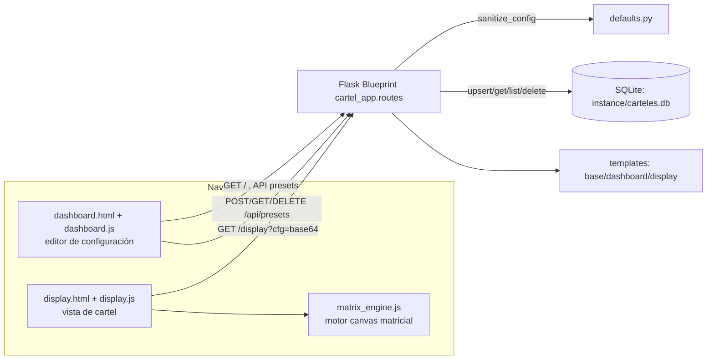

# letrero-web

Editor web de carteles LED y neón con Flask. Soporta modo texto clásico (marquee, bounce, static) y escenas matriciales animadas tipo panel LED físico, con presets persistidos en SQLite.

[](LICENSE)
[](https://python.org)
[](https://flask.palletsprojects.com/)
[](https://github.com/bi0punk/letrero-web/actions/workflows/ci.yml)

## Contenido

- [Características](#características)
- [Arquitectura](#arquitectura)
- [Stack](#stack)
- [Estructura del repositorio](#estructura-del-repositorio)
- [Instalación](#instalación)
- [Uso](#uso)
- [API](#api)
- [Configuración](#configuración)
- [Tests / CI](#tests--ci)
- [Roadmap](#roadmap)
- [Licencia](#licencia)

## Características

- **Modo texto clásico**: animaciones `marquee`, `bounce`, `static` con múltiples estilos LED.
- **Escenas matriciales animadas**: composiciones tipo panel LED programable.
- **9 estilos visuales**: `neon`, `led`, `literal_led`, `lcd`, `billboard`, `minimal`, `pixel`, `plasma`, `retro`.
- **Efectos de texto**: `none`, `rainbow`, `fire`, `ice`, `matrix`.
- **Escenas matriciales**: `custom_banner`, `emoji_parade`, `eyes`, `hearts`, `festive`, `stop_bus`, `arrow_text`.
- **Presets**: guardar, listar, cargar y eliminar configuraciones (SQLite).
- **Pantalla dedicada** en `/display` con configuración pasada por URL.
- Sanitización estricta de la configuración en el backend (colores, tamaños, enums).

## Arquitectura



## Stack

| Componente        | Tecnología                                   |
|-------------------|----------------------------------------------|
| Backend           | Python 3.11+, Flask 3.1                      |
| Frontend          | HTML5, CSS3, JavaScript (canvas)             |
| Motor matricial   | `matrix_engine.js` (capa separada)           |
| Persistencia      | SQLite (presets)                             |
| Testing           | pytest                                       |

## Estructura del repositorio

```
letrero-web/
├── cartel_app/
│   ├── __init__.py         # Factory create_app()
│   ├── db.py               # SQLite (presets)
│   ├── defaults.py         # Config por defecto
│   ├── routes.py           # Rutas Flask + sanitización
│   ├── static/
│   │   ├── css/app.css
│   │   └── js/
│   │       ├── dashboard.js
│   │       ├── display.js
│   │       └── matrix_engine.js
│   └── templates/
│       ├── base.html
│       ├── dashboard.html
│       └── display.html
├── instance/               # DB SQLite (creado al ejecutar)
├── tests/test_smoke.py
├── run.py                  # Entry point
├── start.sh                # Script de inicio
├── requirements.txt
├── pyproject.toml
├── .env.example
├── .github/workflows/ci.yml
└── LICENSE
```

## Instalación

```bash
git clone https://github.com/bi0punk/letrero-web.git
cd letrero-web
python3 -m venv .venv
source .venv/bin/activate
pip install -r requirements.txt
python run.py
```

Abrir en el navegador: [http://127.0.0.1:5000](http://127.0.0.1:5000). También puedes usar `./start.sh`.

## Uso

### Modo texto / cartel clásico

- Animaciones: `marquee`, `bounce`, `static`.
- Estilos: `neon`, `led`, `literal_led`, `lcd`, `billboard`, `minimal`, `pixel`, `plasma`, `retro`.

### Escena matricial animada

Motor canvas para composiciones tipo panel LED, con escenas `custom_banner`, `emoji_parade`, `eyes`, `hearts`, `festive`, `stop_bus`, `arrow_text`.

### Atajos de teclado

| Tecla     | Acción            |
|-----------|-------------------|
| `F`       | Pantalla completa |
| `Espacio` | Pausa / reanuda   |
| `R`       | Reinicia la vista |

## API

| Método | Ruta                        | Descripción                          |
|--------|-----------------------------|--------------------------------------|
| GET    | `/`                         | Interfaz principal (dashboard)       |
| GET    | `/display`                  | Vista de cartel (config por `?cfg=`) |
| GET    | `/api/default-config`       | Configuración por defecto sanitizada |
| GET    | `/api/presets`              | Listar presets                       |
| POST   | `/api/presets`              | Guardar / actualizar preset          |
| GET    | `/api/presets/<int:preset_id>` | Obtener un preset                 |
| DELETE | `/api/presets/<int:preset_id>` | Eliminar un preset                |

## Configuración

Variables de entorno (ver `.env.example`):

| Variable     | Default        | Descripción                |
|--------------|----------------|----------------------------|
| `SECRET_KEY` | (autogenerado) | Clave secreta de Flask     |
| `DEBUG`      | `false`        | Activa el modo debug       |

## Tests / CI

```bash
pip install pytest
pytest tests/ -v
```

CI — GitHub Actions (`.github/workflows/ci.yml`) sobre Python 3.12 con `uv`, disparado en push/PR a `main`/`master`:

- **lint** — `ruff check .`.
- **test** — `pytest -q`.

## Roadmap

- [x] Modo texto clásico con 9 estilos.
- [x] Escenas matriciales animadas.
- [x] Presets persistidos en SQLite.
- [ ] Editor visual de escenas desde la UI.
- [ ] Exportar cartel como GIF animado.
- [ ] Soporte multilenguaje (i18n).
- [ ] WebSockets para sincronización en tiempo real.

## Licencia

MIT — ver [LICENSE](LICENSE).
